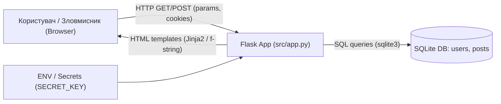

# Модель загроз (STRIDE) та аналіз архітектури (Етап 3)

## 1. Архітектурний контекст та потоки даних (DFD)
Застосунок розгортається як вебсервіс Flask із локальною базою даних SQLite та обслуговує неавтентифікованих і автентифікованих користувачів через HTTP.

**Межі довіри (Trust Boundaries):**
1. **Між клієнтом та Flask (`U <-> W`):** усі параметри запиту (`msg`, `q`, `username`, `password`) та cookie є недовіреними даними.
2. **Між Flask та SQLite (`W <-> DB`):** запити повинні бути строго параметризовані, щоб недовірені дані не інтерпретувалися як SQL-код.
3. **Конфігураційна межа (`ENV -> W`):** секрети та параметри запуску не повинні міститися у відкритому вигляді в коді чи образах.

---

## 2. STRIDE-матриця загроз

| Категорія STRIDE | Потенційна загроза в проєкті | Уражений компонент | Пов'язана вимога |
|---|---|---|---|
| **S — Spoofing** (Підміна ідентичності) | Перебір облікових даних на `/login`; підробка підписаної cookie Flask за відомим `SECRET_KEY` (`hardcoded-dev-secret`). | `/login`, сесійні cookie | `AUTH-1`, `AUTH-2`, `CONF-1`, `SESS-1` |
| **T — Tampering** (Спотворення даних) | Маніпуляція логікою SQL-запитів через `/search?q=...`; підміна HTML-відповіді у `/echo?msg=...`. | `/search`, `/echo`, БД SQLite | `VAL-1` |
| **R — Repudiation** (Відмова від дій) | Відсутність логування успішних/невдалих спроб входу у `/login` унеможливлює аудит інцидентів та виявлення атак підбору пароля. | `/login`, підсистема логування | `LOG-1` |
| **I — Information Disclosure** (Розкриття інформації) | Витік паролів у відкритому вигляді з таблиці `users` через SQLi (`UNION SELECT`); показ сирого SQL-запиту на сторінці `search.html`; витік стеку та Werkzeug PIN/конфігурації через `debug=True`; відсутність `HttpOnly` для cookie. | `/search`, `search.html`, `src/db.py`, `src/app.py` | `STOR-1`, `VAL-1`, `CONF-1`, `SESS-1` |
| **D — Denial of Service** (Відмова в обслуговуванні) | Масовий перебір паролів на `/login` без rate limiting; ресурсоємні запити з wildcard `%` або SQLi в `/search`. | `/login`, `/search` | `AUTH-2`, `VAL-1` |
| **E — Elevation of Privilege** (Підвищення привілеїв) | Отримання доступу до `/profile` будь-якого користувача через підроблену Flask-сесію (за відомим `SECRET_KEY`) або компрометація сервера через активний debug-режим Werkzeug. | `/profile`, Flask session, `app.run(debug=True)` | `AUTH-1`, `CONF-1`, `SESS-1` |

---

## 3. Детальні сценарії можливих атак (≥ 3 сценаріїв)

### Сценарій 1: SQL-ін'єкція (SQLi) та витік облікових даних через `/search` (Ризик R1)
- **Передумови:** маршрут `/search` формує запит через f-рядок `sql = f"SELECT id, title, body FROM posts WHERE title LIKE '%{q}%' OR body LIKE '%{q}%'"`, а шаблон `search.html` додатково виводить виконаний SQL.
- **Кроки атаки:**
  1. Зловмисник відкриває `/search?q=test' UNION SELECT id, username, password FROM users--`.
  2. СУБД SQLite виконує об'єднаний запит до таблиці `users`, де паролі зберігаються у відкритому вигляді (`alice123`, `bob12345`).
  3. Застосунок відображає логіни й паролі всіх користувачів прямо у списку результатів на вебсторінці.
- **Способи виявлення:**
  - **SAST:** `Semgrep` (кастомне правило `flask-sqli-fstring` у `.semgrep.yml` та набір `p/python`), `Bandit` (правило `B608: hardcoded_sql_expressions`).
  - **DAST:** `OWASP ZAP` (перевірка активним/базовим сканером параметрів URL, виявлення SQL-помилок та інформаційного розкриття).
  - **Моніторинг / Тести:** інтеграційні security-тести з payload `' OR '1'='1` та `' UNION SELECT ...`.
- **Заходи пом'якшення:** використання параметризованих запитів `cur.execute("... LIKE ?", (f"%{q}%", ...))`, хешування паролів (`STOR-1`), видалення виводу сирого SQL з `search.html`.

### Сценарій 2: Відображений XSS (Reflected XSS) у `/echo` (Ризик R2)
- **Передумови:** маршрут `/echo` повертає `f"<h1>Echo</h1>
{msg}
"` без екранування HTML, а застосунок не надсилає заголовок `Content-Security-Policy` та не встановлює `HttpOnly` на cookie.
- **Кроки атаки:**
  1. Зловмисник формує фішингове посилання `http://target/echo?msg=` (приклад уже присутній на головній сторінці `index.html`).
  2. Жертва переходить за посиланням у браузері, будучи авторизованою в системі.
  3. Браузер виконує вбудований скрипт у контексті домену застосунку, що дозволяє викрасти дані або виконати дії від імені користувача.
- **Способи виявлення:**
  - **SAST:** `Semgrep` (кастомне правило `flask-reflected-xss-fstring` у `.semgrep.yml`, перевірка формування HTML через f-рядки).
  - **DAST:** `OWASP ZAP` (виявлення віддзеркалення небезпечних символів `<script>`, відсутності заголовків `CSP`, `X-Content-Type-Options`, прапорців cookie).
- **Заходи пом'якшення:** рендеринг через шаблон Jinja2 (де автоекранування увімкнено за замовчуванням) або `markupsafe.escape(msg)`, додавання HTTP-заголовків безпеки (`CSP`, `X-Content-Type-Options: nosniff`) та `SESSION_COOKIE_HTTPONLY=True`.

### Сценарій 3: Підбір паролів (Brute-Force) та підробка сесії (Ризики R3, R4)
- **Передумови:** `/login` не має обмеження частоти запитів та аудиту невдалих спроб; паролі зберігаються у відкритому вигляді; `app.secret_key` має передбачуване значення `"hardcoded-dev-secret"`.
- **Кроки атаки:**
  1. Зловмисник автоматизує перебір паролів до `/login` (наприклад, для користувача `alice`) без жодного блокування чи запису в логи.
  2. Альтернативно, знаючи захардкоджений `SECRET_KEY` з публічного коду / `Dockerfile`, зловмисник підписує власну Flask-cookie з `{"user_id": 1}` утилітою `flask-unsign` та без пароля отримує доступ до `/profile`.
- **Способи виявлення:**
  - **SAST:** `Semgrep` (`flask-weak-hardcoded-secret`, `flask-debug-enabled`), `Bandit` (`B105/B106` — hardcoded password/secret, `B201` — `flask_debug_true`).
  - **DAST:** `OWASP ZAP` (виявлення відсутності `HttpOnly`/`SameSite` на cookie, відсутність захисту від автоматизованих запитів).
  - **Ручний/архітектурний аналіз:** перевірка `src/db.py`, `src/app.py`, `Dockerfile`, `docker-compose.yml`.
- **Заходи пом'якшення:** хешування паролів через `werkzeug.security.generate_password_hash` / `check_password_hash`, впровадження rate limiting на `/login`, обов'язкова ініціалізація `SECRET_KEY` з безпечного середовища (або криптостійка генерація при запуску без захардкодженого значення), вимкнення `debug=True`, аудит подій логіну.

### Сценарій 4: Компрометація через увімкнений Debug-режим та вразливі залежності (Ризики R4, R6)
- **Передумови:** у `src/app.py:63` задано `app.run(host="0.0.0.0", port=5000, debug=True)`, а сторонні залежності (`requirements.txt`) потребують регулярної перевірки на CVE.
- **Кроки атаки:** зловмисник провокує необроблений виняток у маршруті (наприклад, синтаксичну помилку SQL через `/search?q='`), отримує інтерактивну сторінку відладчика Werkzeug зі стеком викликів, фрагментами коду та потенційним доступом до консолі.
- **Способи виявлення:** `Bandit` (`B201: flask_debug_true`), `Semgrep` (`flask-debug-enabled`), `pip-audit` (SCA-сканування залежностей).
- **Заходи пом'якшення:** вимкнути `debug=True` (керувати лише через окрему конфігурацію розробки), додати обробники помилок без виведення трасування стеку користувачу, виконувати регулярний `pip-audit` у CI.

---

## 4. Інтеграція інструментарію аналізу та висновки (початковий аудит коду/архітектури)

Для аналізу вразливостей на рівні архітектури, коду та залежностей до проєкту інтегровано:
1. **Кастомний набір правил `.semgrep.yml`** + стандартні правила Semgrep (`--config auto`) — для виявлення SQLi, XSS, хардкоду секретів та небезпечних налаштувань Flask.
2. **Bandit** (`bandit -r src`) — спеціалізований статичний аналізатор Python-коду (B608, B201, B105 тощо).
3. **pip-audit** — аналізатор відомих уразливостей у залежностях (`requirements.txt`).
4. **OWASP ZAP Baseline** — динамічний сканер HTTP-інтерфейсу, заголовків безпеки та вхідних параметрів.

### Виявлені ризики та знахідки (фіксація стану)
**Початковий ручний архітектурний аналіз підтвердив наявність 7 ключових ризиків (`R1–R7` у `docs/risk-register.csv`):**
- [x] **R1 (SQLi):** підтверджено у `src/app.py:32` — конкатенація `q` в `LIKE '%{q}%'` + розкриття сирого SQL у `src/templates/search.html:11`.
- [x] **R2 (XSS):** підтверджено у `src/app.py:24` — повернення f-рядка `
{msg}
` без екранування.
- [x] **R3 (Weak Auth & Plaintext):** підтверджено у `src/db.py:14, 21-23` та `src/app.py:45` — паролі в plaintext, відсутні rate limiting і аудит.
- [x] **R4 (Hardcoded Secret & Debug):** підтверджено у `src/app.py:7, 63`, `Dockerfile:8`, `docker-compose.yml:8`.
- [ ] **Результати автоматизованого прогону SAST (Semgrep / Bandit / pip-audit) в CI:** *[очікується після першого запуску `.github/workflows/sast.yml`]*.
- [ ] **Результати автоматизованого прогону DAST (OWASP ZAP Baseline) в CI:** *[очікується після першого запуску `.github/workflows/dast.yml`]*.
